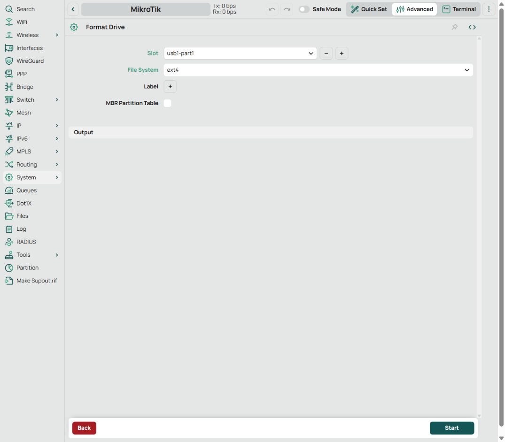
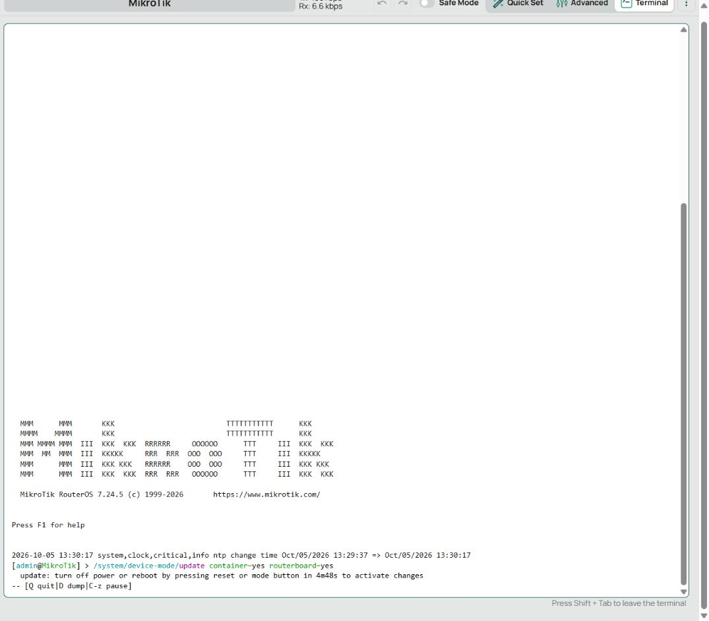

# AWG Control: подготовка и подводные камни

[Установка](README.md#установка) · [Работа с панелью](README.md#работа-с-панелью)

## Подготовка роутера

Список [проверенных устройств](README.md#проверенные-устройства) ведётся в основном README. Автоматический мастер пока проверяет модель **hAP ac²**, архитектуру **ARMv7** и **RouterOS 7.23.8 long-term** с исправлением роста хранилища конфигурации; на других моделях или версиях он остановится. Он устанавливает VPN и панель, но не обновляет RouterOS, не форматирует флешку и не настраивает подключение к провайдеру.

### Обычный интернет и LAN

До установки на роутере должны работать WAN, LAN bridge, DHCP для клиентов, NAT и firewall. WAN должен входить в список интерфейсов `WAN`. Автоматический мастер требует WAN DHCP в состоянии `bound` и один активный default route в `main`; PPPoE, VLAN, статический WAN и несколько провайдеров требуют отдельной интеграции.

LAN — частная IPv4-подсеть `/24` с адресом шлюза `.1`, например `192.168.3.1/24`. WAN и LAN не должны пересекаться. Диапазон `172.18.20.0/22` зарезервирован для служебной сети проекта. В параметрах мастера указывай действительные LAN, bridge и имя USB-раздела, а не автоматически соглашайся с примером.

В **WebFig → IP → DHCP Client → WAN** проверь добавление default route. Для проверки обычного интернета в Terminal:

```routeros
/ip/dhcp-client/print detail
/ip/route/print where dst-address=0.0.0.0/0
/ping 1.1.1.1 count=4
:put [:resolve "example.com"]
```

`no route to host` означает проблему маршрута; успешный ping по IP при неработающем имени указывает на DNS. Удалять существующие правила маршрутизации для прохождения проверки мастера не нужно: активные policy routing, RAW firewall, другие контейнеры или занятый USR требуют ручной проверки совместимости.

### USB, пакет container и device-mode

Сделай резервную копию настроек роутера и сохрани её **на компьютер**. Backup RouterOS не заменяет копию USB и VPN-конфигов.

USB-раздел должен быть смонтирован как ext4 с обычным именем вроде `usb1-part1` и достаточным свободным местом для образа и распаковки. Используй внешнюю флешку, а не внутренние 16 MiB flash hAP ac². В **System → Disks → нужный USB-раздел → Format** можно подготовить ext4; форматирование удаляет содержимое выбранного раздела.



Установи пакет **container** для ARM той же версии, что RouterOS. Разреши контейнеры и управление кнопками в **WebFig/WinBox → Terminal**:

```routeros
/system/device-mode/update container=yes routerboard=yes
```

Выполни физическое подтверждение, указанное RouterOS, и дождись перезагрузки. Программная перезагрузка не заменяет физическое подтверждение. [Документация device-mode](https://manual.mikrotik.com/docs/system-information-and-utilities/device-mode/).



После загрузки проверь `container=yes`, `routerboard=yes`, `flagged=no`, пакет и диск:

```routeros
/system/device-mode/print
/system/package/print
/disk/print detail
```

Для установки нужно не менее 24 MiB свободной RAM и 160 KiB свободной внутренней flash. Нехватку flash при обновлении RouterOS решай отдельно, сохранив backup и доступ по кабелю. Если приходится временно убирать `wireless`, заранее обеспечь восстановление пакета точно той же версии; это не обязательный шаг установки AWG.

### Доступ для установки и панели

Подключи компьютер к LAN MikroTik. В **IP → Services** нужны SSH/SFTP для мастера и `www` на TCP 80 для локального RouterOS REST. Если у `www` ограничен список адресов, сохрани доступ своего LAN и добавь **`172.18.20.2/32`** — адрес контейнера. Панель использует созданного мастером служебного пользователя.

Не открывай WebFig, SSH или панель всему интернету. Панель на TCP 8088 использует HTTP и рассчитана на доверенный LAN. Для одного ПК за вышестоящим домашним роутером ручной генератор поддерживает `--upstream <IP-ПК> --wan-address <WAN-IP-MikroTik>`; это не заменяет LAN-доступ автоматического мастера.

### Компьютер и запуск

Нужны Git, Python 3.10+ с venv/pip и работающий Docker в режиме Linux-контейнеров. Образ ARMv7 собирается локально из закреплённых исходников; ARM-эмулятор не нужен. Требуется доступ к GitHub, PyPI и Docker Hub. Команда Windows в главном README использует `&&`, поэтому рассчитана на **PowerShell 7**; в PowerShell 5 запускай её шаги по отдельности, продолжая только после успешного выполнения предыдущего.

При первом SSH-подключении мастер покажет отпечаток ключа роутера. Перед применением настроек он попросит подтверждение. Пароль администратора MikroTik не сохраняется.

Установка не предназначена для повторного запуска поверх существующих объектов. Если мастер сообщил о конфликте или оборванной установке, сначала собери диагностику. Каталог `awg-control-run-YYYYMMDD-HHMMSS` содержит приватные настройки и откат: не публикуй его и не удаляй до проверки результата.

## Профили и ключи

- Нужен нативный конфиг AmneziaWG: один `[Interface]`, один `[Peer]`, IPv4-адрес туннеля и полный IPv4-маршрут в `AllowedIPs`.
- Параметры обфускации и ключи бери из рабочего конфига сервера. Не заменяй H1–H4, S1–S4, I1–I5 или HeaderProtectionKey произвольными значениями.
- Shell-хуки `PreUp`, `PostUp`, `PreDown`, `PostDown`, поля `Table`, `FwMark` и неизвестные параметры отклоняются. Сетевые команды выполняет контроллер.
- IPv6-записи можно хранить в тексте, но трафик этой установки — только IPv4. Активный IPv6-интернет блокирует установку.
- Ключи находятся на USB, видны в редакторе и попадают в экспорт профиля. Их нет в списке профилей и штатной диагностике. Активный профиль и сохранённый для возврата профиль нельзя удалить.

При активации проверяются handshake, принятые байты и TCP-доступ к `1.1.1.1:443`. Проверка занимает до 35 секунд; при ошибке контроллер пытается вернуть рабочий профиль. Этот тест внутри контейнера не заменяет проверку DNS и сайтов на клиенте за MikroTik.

## Как проверить разделение Geo

Загруженные списки сами по себе не включают выборочную маршрутизацию. В **Devices → Global routing mode** выбери **Geo** и нажми **Apply changes**. **Use global (Geo)** у устройства означает наследование этого режима; явно выбранный **VPN** по-прежнему направляет весь его интернет через туннель.

Дождись завершения применения и проверь **Diagnostics → ready**. При загрузке или ошибке применения Geo временно использует VPN для всего интернета; надпись **Connected** подтверждает только соединение VPN.

Для проверки открой на устройстве за MikroTik сайт вне списков и выбранный Geo-сервис, затем сравни два снимка **Diagnostics → mangle**. В активной цепочке `AWG3UI-a` или `AWG3UI-b` должны расти счётчики разных правил:

- `new-routing-mark=main`, `src-address-list=AWG3UI-ready` — прямой внешний трафик, не совпавший со списками;
- `new-routing-mark=to-awg`, `dst-address-list=AWG3UI-ip-*` или `AWG3UI-dns-live` — совпадения по IP или доменам;
- последнее правило `to-awg` без условий — защитный маршрут на время неготовности Geo. После появления `ready` его счётчик не должен расти; ненулевое старое значение при переключении допустимо.

Счётчики локальных сетей не доказывают прямой выход в интернет. При нескольких режимах устройств учитывай также `src-mac-address` правила. Для проверки фактического выхода используй **IP → Firewall → Connections** или наблюдение за нужным соединением на WAN и интерфейсе контейнера. Нужны новые соединения после применения режима. LAN-трафик должен обходить FastTrack, как настроено установщиком: иначе ускоренные пакеты обходят firewall/mangle ([документация MikroTik](https://help.mikrotik.com/docs/spaces/ROS/pages/130220087/Connection+tracking)).

Один сайт проверки IP может ввести в заблуждение: если он размещён в выбранных сетях Cloudflare, Google или Amazon, VPN-IP для него ожидаем. Выбери адрес вне своих списков. Обычный трафик DNS при включённом VPN также идёт через туннель независимо от режима устройства.

## Счётчики Direct / VPN

**Device traffic** показывает накопленные байты и пакеты IPv4 для настроенной LAN: общий объём, Download и Upload отдельно. Счёт начинается с установки правил; перезагрузка RouterOS, ручное обнуление или пересоздание правил сбрасывает значения. Обновление Geo, переключение VPN и перезапуск одного контейнера счётчики не пересоздают. История на диск не записывается.

Четыре правила `AWGC traffic ...` с `action=passthrough` считают трафик между LAN и WAN либо интерфейсом AWG в обе стороны. Они не меняют маршруты и не разрешают/блокируют соединения. Локальные, служебные и multicast-диапазоны исключены; обращения к панели, DNS самого роутера и зашифрованный транспорт контейнера не учитываются повторно. Это сетевые байты с заголовками и повторными передачами, а не размер скачанных файлов. Учёт происходит в mangle/forward, до фильтра forward: попытки передачи, которые последующий фильтр отклонит, тоже могут попасть в счётчик ([порядок обработки RouterOS](https://help.mikrotik.com/docs/spaces/ROS/pages/328227/Packet+Flow+in+RouterOS)).

Небольшие списки `AWGC-traffic-local` и `AWGC-traffic-ready` создаются с `dynamic=yes` только в RAM. После старта роутера учёт ждёт их восстановления. Внутренняя flash хранит лишь четыре небольших постоянных правила; при опросе панели записей нет. Раз в 5 секунд читается только маленькая таблица mangle, без перебора Geo-списков и соединений. При недоступности роутера или повреждении правил UI показывает отсутствие данных, а не ложные нули. Диагностика содержит отдельное поле `traffic`.

Если вручную включить FastTrack для этой LAN или обойти роутер другим шлюзом, часть трафика не попадёт в учёт. Для сравнения с прежними `AWG3UI-*` помни: правила маршрутизации считают только исходящее направление, а **Device traffic** складывает оба.

## DNS и Geo

DNS общий для устройств: при подключённом VPN MikroTik обращается к приватному DNS-обработчику AWG Control в том же контейнере (`172.18.20.2:53`), который использует DNS профиля через туннель. Режим Direct относится к интернет-трафику устройства, но не создаёт отдельный DNS-сервер для него. После **Disconnect** или остановки кнопкой Reset/WPS роутер использует DNS-адреса профиля напрямую через WAN.

В RouterOS преобразование массива через `:tostr` соединяет DNS-адреса точкой с запятой. Такую строку нельзя подставлять в команду `servers=`: нужен список через запятую. Установщик сохраняет исходные DNS с правильным разделителем. Если при остановке возникает `bad command name 1.0.0.1`, проверь источник `awg-control-restore-dns` в **System → Scripts**: `servers=1.1.1.1;1.0.0.1` — ошибочная команда; корректная запись для этих адресов — `servers=1.1.1.1,1.0.0.1`. Сохрани свои фактические DNS, затем проверь разрешение имён при отключённом VPN.

GeoSite работает через DNS MikroTik и адресные списки. Клиентам нужен DNS роутера. Browser DoH, Android Private DNS и сторонние DNS могут обходить доменные правила. Общий IP CDN иногда отправляет через VPN и другие домены. Устройства за дополнительным NAT нельзя различить по исходным MAC.

Geo-источники скачиваются через подключённый VPN. При отключённом соединении можно применить сохранённые списки, но нельзя скачать новые. GeoSite проверяется по опубликованной SHA256; keyword не поддерживается; regexp принимается только в ограниченном ASCII/POSIX-подмножестве. Чужие RouterOS-скрипты из источников не выполняются.

RouterOS DoH и динамические DNS-серверы могут обходить контейнер: установка и подключение отклоняются, если они настроены. Проверь **IP → DNS → Use DoH Server** и **Dynamic Servers**. При DHCP на WAN отключи **Use Peer DNS** в его DHCP Client; при PPPoE — в настройках PPPoE-клиента. Перед этим должны быть указаны рабочие статические DNS в **IP → DNS → Servers**. Проверь разрешение имён через обычный WAN. Установщик не меняет чужую конфигурацию DoH/DHCP автоматически.

Приватный DNS-обработчик принимает UDP и TCP только от адреса роутера `172.18.20.1`; публиковать порт 53 контейнера в LAN/WAN не нужно. При обновлении уже работающей установки обнови также обработчики кнопок через `panel/prepare.py --buttons-only`: Reset должен вернуть прямой DNS даже после полной остановки контейнера. Без этого подключения к VPN отклоняются с объяснением.

Для VPN-сервера с доменным именем сохраняется последний разрешённый публичный IPv4: он помогает запуститься, когда DNS роутера направлен в ещё не поднятый VPN. Если адрес сервера сменился и подключение не восстанавливается, выполни **Disconnect → Connect**.

### Время, NTP и запуск после отключения питания

После перезагрузки hAP ac² часы могут отставать. В нашем случае роутер показывал 6 октября вместо 20 октября, а подключение завершалось `VPN verification timed out`. Установка корректного времени и повторное подключение восстановили VPN.

Причина замкнутого круга: NTP был настроен на `time.cloudflare.com`, а DNS самого роутера — через AWG. При неудачном подключении состояние остаётся «VPN включён, соединения нет»: маршруты DNS через туннель сохраняются. NTP не может разрешить имя сервера, часы не синхронизируются, VPN не устанавливает соединение. Сам NTP при этом должен выходить через обычный WAN. Сдвиг часов назад мешает защите handshake от повторного воспроизведения; [описание протокола WireGuard](https://www.wireguard.com/protocol/) объясняет использование временных меток.

**Установщик и `panel/prepare.py` теперь добавляют NTP-серверы по IPv4**: `162.159.200.1` и `162.159.200.123` — [адреса сервиса Cloudflare](https://developers.cloudflare.com/time-services/ntp/usage/). Существующие записи остаются на месте; совпадающие адреса не дублируются. Мастер включает NTP-клиент и ждёт `status=synchronized` до **120 секунд**, прежде чем менять сетевую интеграцию и запускать контейнер. Нужны обычный WAN и исходящий UDP 123. Firewall и DNS ради этой проверки не ослабляются.

При тайм-ауте установка останавливается и собирает диагностику. Настройки NTP уже могли быть применены: сначала разбери причину, затем используй откат текущего запуска перед повторной установкой. Откат удаляет только добавленные мастером NTP-записи с меткой `AWGC bootstrap NTP` и возвращает прежний флаг `enabled`; существующие серверы и их параметры сохраняются. Режим NTP кроме `unicast`, VRF кроме `main` и NTP с ключами аутентификации требуют ручной интеграции — мастер останавливается до изменений, чтобы не заменять такую настройку публичными источниками времени.

Для **уже установленной панели** проверь дату и NTP в Terminal:

```routeros
/system/clock/print
/system/ntp/client/print
/system/ntp/client/servers/print detail
```

Для обычного NTP без ключей в `unicast`/`main` можно добавить отсутствующие IP-серверы, сохранив имеющиеся:

```routeros
:foreach address in={"162.159.200.1";"162.159.200.123"} do={
    :if ([:len [/system/ntp/client/servers/find where address=$address]] = 0) do={
        /system/ntp/client/servers/add address=$address iburst=yes
    }
}
/system/ntp/client/set enabled=yes
```

Дождись `status=synchronized` и правильной даты, затем нажми **Connect/Reconnect** в панели. Если NTP не синхронизируется, проверь WAN, UDP 123 и параметры существующих NTP-серверов. После включения питания WAN и NTP также должны успеть заработать; если первоначальное подключение завершилось ошибкой, повтори его после синхронизации. Проверка времени в установщике выполняется при установке, а не перед каждым запуском контейнера. [Документация NTP RouterOS](https://help.mikrotik.com/docs/spaces/ROS/pages/40992869/NTP).

**Проверка 20 октября 2026:** на hAP ac² с RouterOS 7.24.5 и панелью 0.2.3 выполнена `/system/reboot`. Перед ней VPN был включён, у контейнера задано `start-on-boot=yes`, NTP использовал IP-серверы выше. После загрузки часы автоматически синхронизировались с `162.159.200.1`, панель запустилась и VPN подключился без нажатия Connect: при uptime `1m47s` диагностика показала `connected=true`, новый handshake и полученный трафик. Отдельно подтверждены `status=synchronized` и правильные дата и время. Холодный старт после отключения питания и запуск при задержке WAN/NTP этой проверкой не покрыты.

**Повторная проверка с неверной датой:** на том же роутере установлена дата `2026-09-30` (на 20 дней назад), сразу выполнена перезагрузка; NTP оставался включённым. Журнал после загрузки подтвердил `ntp change time Sep/30/2026 18:49:37 => Oct/20/2026 18:50:17` (UTC). Новый handshake произошёл в `18:50:22 UTC`, через 5 секунд после коррекции часов. При uptime `1m47s` диагностика показала `connected=true`, RX 639 байт и TX 1748 байт. Отдельная проверка NTP подтвердила `synchronized` и источник `162.159.200.123`. Connect/Reconnect после перезагрузки не нажимали. Фикс прошёл проверку загрузки с отстающими часами при доступном WAN и NTP.

## Маршруты и firewall

**Явный Disconnect или остановка контейнера возвращает устройствам обычный интернет.** При неудачном подключении или неожиданном падении движка отмеченный VPN-трафик блокируется, пока соединение не восстановится или не будет явно выключено. Локальные частные IPv4-сети остаются доступными напрямую.

В таблице `to-awg` есть резервный blackhole; у контейнера FORWARD по умолчанию DROP. Зашифрованному транспорту разрешён выход только к UDP endpoint VPN. LAN обходит FastTrack. MTU/MSS рассчитываются из профиля.

Правила `accept` должны стоять выше соответствующих `drop`. Каждое `place-before=0` добавляет правило в начало, поэтому порядок команд и итоговый порядок правил различаются. Ответы DNS на запросы самого роутера проходят через **`AWGC router replies`** перед **`AWGC input guard`**. Удаление или перенос этого разрешения приводит к ситуации «VPN подключён, но сайты не открываются».

## Защита маршрута VPN

Начиная с 0.2.4 контроллер проверяет маршрут в `to-awg` перед подключением, после проверки туннеля и каждые 5 секунд при включённом VPN. Если у единственного маршрута проекта к `172.18.20.2` случайно установлен `disabled=yes`, контроллер включает его обратно и проверяет активность через `docker-awg-veth`. Проверка учитывает резервный blackhole; обычные проверки без ошибок ничего не записывают в конфигурацию RouterOS.

Это устраняет случай «handshake есть, но у Wi-Fi нет интернета и DNS». Сам handshake больше не даёт статус **Connected** и горящий USR без недавней успешной проверки маршрута. При ошибке появляется **Route unavailable**; в **Diagnostics** доступны `routes`, правила `AWGC DNS` и `tunnel.route` с временем проверки, числом восстановлений и последней ошибкой. Восстановление также отмечается в журнале контейнера и рядом со статусом профиля. Недоступность API дольше 20 секунд делает сохранённую проверку устаревшей. Проверки приостанавливаются на время операций панели; обычный интервал 5 секунд не является гарантией времени восстановления при перегрузке или недоступности RouterOS.

Защита действует только для включённого VPN. **Disconnect**, Mode и остановка контейнера сохраняют обычное поведение: фоновая проверка не включает VPN обратно. Удалённые, дублирующиеся, посторонние маршруты, изменённый gateway или повреждённый blackhole автоматически не перезаписываются — требуется исправить интеграцию. Это защита от отключения конкретного маршрута, а не от произвольного изменения всей конфигурации или сброса роутера.

После установки используй обычные разделы **WebFig/WinBox**, а не **Quick Set**: мастер может одновременно менять Wi-Fi, DHCP, DNS и маршруты. Пароль Wi-Fi меняется в **Wireless → Security Profiles**. MikroTik [не рекомендует смешивать Quick Set и расширенную настройку](https://help.mikrotik.com/docs/spaces/ROS/pages/328060/Quick%2BSet).

Проверено на hAP ac² / RouterOS 7.24.5 **20 октября 2026 года**: при работающем VPN маршрут намеренно отключили; контроллер восстановил его за 1 секунду, после чего прошли ping и DNS. После **Disconnect** маршрут оставался отключённым дольше одного цикла проверки, туннель был остановлен, USR погашен. Следующий **Connect** восстановил маршрут до подключения VPN; диагностика зарегистрировала оба восстановления. Это проверка конкретного сбоя, а не гарантия секундного восстановления при любой нагрузке.

## Кнопки и USR

**Mode находится у USB, Reset/WPS — у питания.** Короткий Reset до 2 секунд в работающем RouterOS останавливает контейнер и даёт две вспышки USR. Удержание Reset при подаче питания по-прежнему относится к заводскому восстановлению/сбросу: настройки загрузчика установщик не меняет. [Документация кнопок](https://help.mikrotik.com/docs/spaces/ROS/pages/40992878/RouterBOARD#RouterBOARD-ModeandResetbuttons).

После полной остановки недоступна и панель, отключён `start-on-boot`. Одно нажатие Mode запускает контейнер, включает автозапуск и подключает профиль. Альтернатива — **WebFig → Container → awg-control → Start**, затем **Connect** в панели.

`awg-mode` и `awg-stop` требуют только `read,write,test`. Лишнее требование `policy` может привести к `from sys2 failed ... not enough permissions` при физическом нажатии. Ручной запуск из админского терминала использует права администратора и не заменяет проверку кнопки. Отключать проверку прав через `dont-require-permissions=yes` не требуется.

Панель не меняет USR во время выполнения обработчиков кнопок. В остальное время она проверяет свежесть handshake и маршрут VPN каждые 5 секунд; окно handshake зависит от RejectAfterTime и составляет минимум 240 секунд. Горящий USR не означает непрерывную проверку каждого сайта.

## Ресурсы

### Свои Geo-правила

В **Geo lists → Your own Geo rules** можно использовать только собственные правила, без готовых категорий. Они действуют на устройства в режиме **Geo**: совпавшие назначения идут через VPN, остальные — напрямую. Устройства **Direct** и **VPN** сохраняют свой режим. Локальные сети всегда имеют приоритет и идут напрямую.

- Домены: `example.com` или `domain:example.com` — имя и поддомены; `full:example.com` — только имя. Международные имена указывай в Punycode. URL страницы, маски, regexp, keyword, hosts и Adblock-синтаксис не поддерживаются.
- IPv4: отдельный адрес или CIDR. Адрес превращается в `/32`, подсеть нормализуется по маске. IPv6 в собственных правилах отклоняется с ошибкой.
- Ссылки: публичный HTTPS на порту 443, прямой текстовый файл до **1 MiB**. В одном файле разрешено смешивать домены, IPv4 и подсети; одна запись на строку, `#` начинает комментарий. Нужен raw/download URL, а не HTML-страница GitHub. Локальные/служебные адреса, логин в URL и небезопасные перенаправления запрещены. Загрузка идёт через подключённый VPN.

Дубли объединяются; правило с поддоменами включает точное правило того же имени. Все категории и свои правила делят общий лимит **32 768 IPv4-префиксов / 2 048 доменных правил**; категории и ссылки — **12 источников**. Имена, уже покрытые родительским доменом, убираются перед применением, но проверка лимита выполняется до этого сокращения. Размер файла не гарантирует, что его правила поместятся в память.

**Apply changes** сохраняет правила после успешного применения; **Update lists** заново скачивает сохранённые источники. При ошибке загрузки, разбора или превышении лимита действующие списки не заменяются, введённые правки остаются в форме. Ошибка указывает номер списка и, для некорректной строки, её номер. Ссылки могут содержать приватные токены в query string: хранятся на USB вместе с настройками, поэтому не делись каталогом данных.

Доменные правила требуют DNS MikroTik так же, как GeoSite. DoH/Private DNS могут обходить их. Свои IP/подсети работают независимо от DNS.

| Ресурс | Предел |
|---|---|
| Профили | 16 по 16 KiB; активен один |
| IPv4-префиксы / домены | 32 768 / 2 048 суммарно |
| Устройства / категории источников | 24 / 12 |
| Контейнер | memory-high 24 MiB, memory-max 32 MiB |
| Go: контроллер / движок | GOMEMLIMIT 8 / 12 MiB |
| Выученные DNS IPv4 / временные доменные псевдонимы | 8 192 / 2 048 |
| Параллельные DNS-запросы / TTL ответа | 16 / до 300 секунд |

Go-лимиты — мягкие цели сборщика мусора, а не гарантия общего расхода RAM. Слишком большие списки отклоняются целиком. DNS-обработчик проверяет лимит до выдачи ответа: если новый адрес нельзя добавить в RAM, клиент получает временную ошибку DNS, а в панели и Diagnostics появляется причина.

## Большие Geo-списки: USB и RAM

**Файлы Geo и доменные правила хранятся только на USB**, в `awg-control-data`. Снимок источников — в `state.json`, незавершённое применение — в `pending.json`, краткоживущие DNS-адреса и псевдонимы — в `dns-routes.json` и `dns-aliases.json`. Рабочие IPv4-списки RouterOS создаются с `dynamic=yes` и находятся только в RAM. Новые записи **IP → DNS → Static** для Geo не создаются. Это важно: сама по себе флешка не увеличивает внутреннее хранилище конфигурации RouterOS.

Во внутренней конфигурации остаются небольшие служебные маршруты, правила устройств, назначения кнопок, загрузчики `/import` и один скрипт с DNS-адресами профиля для полной остановки. Их размер не зависит от числа Geo-доменов и подсетей. Нулевую запись во flash для самой конфигурации роутера обещать нельзя; большие списки туда не записываются. Разница между временными и постоянными адресными списками описана в [документации MikroTik](https://manual.mikrotik.com/docs/firewall-and-quality-of-service/firewall/address-lists/).

IPv4 добавляются и удаляются порциями по 512 записей. Оставшиеся служебные DNS Static от прежнего применения удаляются порциями по 64; посторонние записи сохраняются. Массовая команда может превысить время REST и дать `HTTP 400 ... Session closed`. Команды каждой порции, не более 48 KB, записываются в `awg-control-data/router-awg-ui-apply.rsc` на USB; постоянный загрузчик импортирует этот файл. Не удаляй и не меняй эти файлы во время работы панели.

Домены сопоставляются внутри контейнера. Обработчик учитывает CNAME, цели HTTPS/SVCB и IPv4-подсказки этих записей. Он сначала подтверждает добавление нужного адреса в `AWG3UI-dns-live`, сохраняет его срок на USB, затем возвращает ответ клиенту. Адреса имеют таймаут TTL + 60 секунд; TTL ответов ограничен 300 секундами. Повторные ответы используют ещё действующую запись. После перезагрузки актуальные адреса восстанавливаются с USB до готовности Geo: клиенты могут продолжать пользоваться своим DNS-кешем.

Для DNS используются команды REST **POST add/set**, которые возвращают идентификатор или подтверждение. Обычные PUT/PATCH дополнительно возвращают всю запись: на проверенном hAP ac² с 21 тысячей подсетей это занимало около 5 секунд на адрес и приводило к `SERVFAIL`. Проверка POST на той же таблице дала 9 мс для добавления и 6 мс для обновления; это отдельное измерение, а не гарантия задержки всех DNS-запросов. В диагностике состояние туннеля снимается до медленного чтения таблиц RouterOS, чтобы таймаут API не превращался в ложное сообщение об отключённом VPN.

Обработчик не ведёт отдельный кеш DNS-ответов: кеширует RouterOS. Он допускает до 128 записей в ответе и до 64 адресов/псевдонимов за запрос. Если RAM, USB или Router API недоступны, выбранный домен получает `SERVFAIL`, а не ответ без правила маршрутизации. Уже открытые соединения и клиенты с собственным DoH/Private DNS этой проверкой не покрываются. Выученные адреса сохраняются до истечения TTL, поэтому удаление домена из списка может не сразу убрать его IP из VPN-маршрутизации.

Большой набор применяется несколько минут. После запуска сначала восстанавливается снимок с USB (до 15 минут), затем подключается VPN с отдельным ожиданием до 130 секунд. Панель показывает этап и количество записей; не запускай повторное применение до завершения. Опрос UI передаёт только счётчики и не перебирает большой firewall address-list: на hAP ac² поиск одной служебной записи среди 21 тысячи префиксов занимал около 7 секунд.

Для начала применения требуется минимум 12 MiB свободной RAM и 160 KiB flash. Geo временно переводится на весь интернет через VPN, прежние IPv4-списки освобождаются из RAM, сохранённый снимок остаётся на USB. Это позволяет обновлять большой набор без двух полных копий в памяти.

После освобождения старых списков контроллер проверяет запас: резерв 14 MiB плюс оценка для нового списка (256 байт на префикс и 1 KiB на доменное правило). Это консервативная оценка, а не точное измерение расхода. Во время загрузки каждая порция проверяет минимум 12 MiB RAM и 128 KiB flash. Не все наборы предельного размера поместятся на hAP ac². Если памяти всё же не хватило после подготовки, Geo остаётся через VPN до успешного применения меньшего набора.

Новый набор включается после проверки количества IPv4 и отсутствия служебных DNS Static. При сбое загрузки неактивная часть удаляется; Geo остаётся через VPN до успешного **Apply changes**. Сбой уже после переключения не удаляет активный набор. При намеренном отключении VPN интернет всех режимов идёт напрямую, как и раньше. Невыполненное применение нельзя считать сохранённым.

Подключённый VPN и применённые Geo-списки — разные проверки. После ошибки применения повторный **Connect** не убирает предупреждение о Geo. Счётчики показывают сохранённый на USB снимок; при ошибке рядом появляется **Saved snapshot; Geo rules need attention**. Фактическая готовность списков доступна в **Diagnostics → ready**.

Если в журнале есть `could not save configuration changes, not enough storage space available`, прекрати повторные загрузки и проверь **System → Resources → Free HDD Space**. Даже при работающем интернете новые настройки могут не сохраняться. Сохрани существующие резервные копии на компьютер и обеспечь локальный доступ до перезапуска или восстановления. Перенос данных на USB и перезапуск сами по себе не гарантируют освобождения уже заполненного хранилища конфигурации; после восстановления нужно повторно проверить место и журнал. Не снижай порог flash ради обхода этой ошибки.

**Ошибка хранилища в самой RouterOS.** В [7.23.8 long-term](https://forum.mikrotik.com/t/7-23-8-long-term-is-released/273689) MikroTik исправила рост хранилища конфигурации при изменении динамических записей. Поэтому флаг `dynamic=yes` и хранение исходников на USB сами по себе не гарантируют отсутствие роста flash на версии без этого исправления. На нашем hAP ac² с 7.24.5 после заполнения flash осталось 20 KiB: перезапуск не освободил место, а удалённые DNS Static вернулись, поскольку изменения не сохранились. Это наблюдение совместимо с указанной ошибкой, но не доказывает, что только она заняла всё место. До большой загрузки нужны исправленная версия RouterOS и проверка запаса flash после применения и перезапуска; переустановку или смену ветки выполняй отдельно от мастера, с резервными копиями и доступом по кабелю.

GeoSite принимает до **32 regexp** в общем лимите доменных правил. Совместимые выражения нормализуются в ASCII/POSIX ERE и обрабатываются в Go внутри контейнера: в частности, `\d`, `\w`, `\s` и их отрицания вне символьных классов. Lookaround, специальные группы, word boundaries, Unicode-классы и другой несовместимый синтаксис отклоняются целиком. Для ASCII/Punycode-имён `\S` преобразуется в `[!-~]`; именованные POSIX-классы в исходниках отклоняются. Свои текстовые правила принимают только обычные домены и CIDR. Regexp требуют больше CPU, чем суффиксы.

Проверка DNS-пересечений сохраняет посторонние записи: ответы RouterOS Static могут не попасть в контейнер. Обычное локальное имя, не совпадающее с Geo-правилами, не мешает применению. Точная A-запись допустима, если её IP уже покрыт GeoIP. Пересечения с чужими regexp, суффиксными переопределениями и непокрытыми адресами отклоняются. Во время большой загрузки панель показывает **Updating lists**; проверка здоровья маршрута возобновляется после завершения операции.

Лимиты 32 768 / 2 048 не снимают ограничения памяти роутера и лимит динамических DNS-адресов. Полные `ip` / `ipresolve` Antifilter по-прежнему могут не поместиться. Проверяй текущий размер источников; состав меняется со временем.

**Проверка 21 октября 2026:** hAP ac², RouterOS/container/wireless 7.23.8 long-term. GeoSite `kinopub,amazon,youtube,google,discord,category-ai-!cn`, GeoIP `telegram,cloudflare,google`, Antifilter `allyouneed` и 23 пользовательских домена дали **21 660 IPv4-префиксов и 1 298 доменных правил**. Все IPv4-записи были динамическими; служебных Geo DNS Static — 0. После замены и запуска контейнер восстановил весь снимок с USB, подключил VPN, диагностика подтвердила `ready` и отсутствие ошибок DNS. Ответы через DNS MikroTik: YouTube 384 мс, Discord 149 мс, обычный домен 72 мс; это разовые измерения без нагрузки. Свободно 328 KiB flash и примерно 25–28 MiB RAM. Обработчик Mode проверен запуском его скрипта: отключение/включение, возврат DNS и USR работают. Полная остановка отработала во время установки. Физические кнопки проверялись ранее; холодный старт с этим большим набором и длительная нагрузка пока не проверены.

## Пароль панели

Пароль AWG Control и пароль администратора RouterOS — разные учётные данные. В **Settings → Panel access** новый пароль задаётся без старого: достаточно действующей сессии панели. Используй 16–256 символов. Сохранение происходит без перезапуска VPN; текущая сессия обновляется, остальные отзываются. Поэтому не оставляй открытую панель на чужом компьютере.

Для сброса при потере доступа нужен Python 3.10+ на компьютере и доступ администратора к WinBox/WebFig. Docker, SSH и старый пароль панели не нужны:

```sh
python panel/reset-password.py
```

На Linux/macOS можно использовать `python3`. Скрипт запрашивает новый пароль дважды без отображения ввода и создаёт приватный каталог `awg-password-reset-...`. На этом этапе роутер не меняется. Пароль открытым текстом не записывается; в `reset-password.rsc` находятся соль и PBKDF2-хеш.

1. В WinBox/WebFig → **Files** загрузи `reset-password.rsc` в `usb1-part1`.
2. Контейнер `awg-control` должен работать. Если он остановлен, сначала запусти его в **Container**; Mode также запускает VPN.
3. Выполни в **Terminal**: `/import file-name=usb1-part1/reset-password.rsc`.
4. Подожди 10–20 секунд и войди в панель с новым паролем.

Сброс через скрипт кратко перезапускает контейнер и прерывает VPN; профили, правила маршрутизации и сохранённое состояние соединения не меняются. В отличие от смены через UI, все сессии панели закрываются. Во время выполнения не нажимай Mode/Reset. Для другого диска или имени контейнера укажи `--disk ИМЯ --container ИМЯ` при генерации.

Перед записью создаётся копия `awg-control-data/settings-password-<идентификатор>.json` на USB. При необходимости загрузи парный `restore-password.rsc` из того же каталога и выполни `/import file-name=usb1-part1/restore-password.rsc`: он вернёт прежние настройки входа и перезапустит контейнер. Ему также нужен работающий контейнер; если запуск сломан, восстанови `settings.json` из указанной копии через Files вручную. Не используй старую копию после других изменений настроек панели. Повторный импорт одного и того же сброса отклоняется, чтобы не затереть резервную копию.

Файлы сброса, отката и резервные копии держи приватными; копия настроек содержит служебный пароль RouterOS. Генератор не обходит авторизацию RouterOS и не сбрасывает сам роутер. Команды импорта и разбора JSON описаны в [документации RouterOS](https://help.mikrotik.com/docs/spaces/ROS/pages/47579229/Scripting).

## Диагностика

В панели открой **Diagnostics**. Для отчёта с компьютера, из каталога репозитория:

```powershell
.\.venv\Scripts\python.exe panel/install.py --diag --host 192.168.3.1
```

Linux/macOS: замени `.\.venv\Scripts\python.exe` на `.venv/bin/python`. Используй фактический LAN-IP роутера.

Режим `--diag` не меняет настройки. Он выводит отчёт и сохраняет его в каталоге запуска. При ошибке установки диагностика также собирается автоматически. Содержимое VPN-конфигов и пароли в отчёт не включаются; сетевые адреса и MAC могут присутствовать.

Для проверки в **WebFig → Terminal**:

```routeros
/container/print
/system/clock/print
/system/ntp/client/print
/system/ntp/client/servers/print detail
/routing/rule/print where comment~"^AWG"
/ip/route/print where routing-table=to-awg
/ip/firewall/filter/print stats where comment~"^AWGC"
/system/routerboard/mode-button/print
/system/routerboard/reset-button/print
/log/print where topics~"script" and message~"AWGC|awg-mode|awg-stop"
```

| Симптом | Что проверить |
|---|---|
| Контейнер не запускается | Пакет container, device-mode, ext4, место, RAM, окончание распаковки |
| Панель не открывается | Контейнер запущен, клиент в LAN, правильный адрес и TCP 8088 |
| Router API unavailable | `www` на 80, доступ с 172.18.20.2, разрешения служебного пользователя |
| Нет handshake / `VPN verification timed out` после перезагрузки | Правильная дата, NTP `synchronized`, затем endpoint, UDP-порт, параметры профиля и firewall |
| Handshake есть, сайты не открываются | DNS роутера, `AWGC router replies`, маршруты и NAT LAN |
| Внешний IP не изменился | Клиент подключён именно к MikroTik, режим Devices, FastTrack, новые соединения браузера |
| Часть сайтов зависает | MTU/MSS и доступность сервера |
| Кнопка не работает | Её расположение, device-mode, on-event и ошибки прав в журнале |
| `no such item` в Terminal | Ищи объект по имени; номера после `print` непостоянны |

Управление из Terminal при работающем контейнере:

```routeros
/container/shell [/container/find where name="awg-control"] cmd="/awg-control --control diag" no-sh
/container/shell [/container/find where name="awg-control"] cmd="/awg-control --control disconnect" no-sh
/container/shell [/container/find where name="awg-control"] cmd="/awg-control --control connect" no-sh
/container/shell [/container/find where name="awg-control"] cmd="/awg-control --control restart" no-sh
```

Команда подтверждает приём запроса; итог смотри в панели. Ошибки подключения сохраняются в `last-error.json` на USB.

## Резервные копии и откат установки

Сохраняй отдельно backup RouterOS, свои `.conf`, каталог данных на USB и приватный каталог запуска мастера. Данные профилей и панели находятся в `USB/awg-control-data`.

Для отмены изменений конкретного запуска на том же роутере:

```powershell
.\.venv\Scripts\python.exe panel/install.py --rollback awg-control-run-YYYYMMDD-HHMMSS --host 192.168.3.1
```

Подставь сохранённый каталог и адрес роутера. Скрипт отката также загружается на USB:

```routeros
/import file-name=usb1-part1/awg-control-rollback.rsc
```

Откат удаляет созданную интеграцию, добавленные мастером NTP-серверы и возвращает сохранённые DNS, состояние NTP-клиента и настройки Reset. Файлы USB остаются для разбора. Он не восстанавливает отформатированные данные и не гарантирует восстановление доступа при любой неисправности; сохраняй локальный доступ и backup.

## Ручная сборка и привязка кнопок

Перед повторной распаковкой образа останови прежний контейнер AWG: RouterOS может повторно использовать общий слой даже при другом `layer-dir` и завершить распаковку ошибкой `Text file busy`. Для нового контейнера оставь отдельный `root-dir` на USB, чтобы сохранить прежний для отката. Не запускай оба контейнера с одним каталогом данных. Перед обновлением сохрани `state.json` — прежняя версия может не понимать новые поля правил.

Для просмотра подготовленных команд без изменения роутера:

```sh
python panel/build.py --output awg-control.tar
python panel/prepare.py --output awg-control-private
```

Генератор создаёт `settings.json`, `setup.rsc`, `rollback.rsc`; этот каталог приватный. При ручной установке загрузи настройки как `usb1-part1/awg-control-data/settings.json`, образ как `usb1-part1/awg-control.tar`, а скрипты — на USB. Профиль импортируется через панель после запуска. Полную последовательность загрузки и создания контейнера выполняет мастер из главного README.

Чтобы заново назначить кнопки существующей установки:

```sh
python panel/prepare.py --buttons-only --lan 192.168.3.0/24 --output awg-buttons-update
```

Загрузи полученный `buttons.rsc` на USB и выполни `/import file-name=usb1-part1/buttons.rsc`. Укажи свой LAN. Скрипт не меняет профили и не запускает/останавливает контейнер; постороннюю привязку Reset он не перезаписывает. Снять назначение Reset отдельно можно командой `/system/script/run awg-control-restore-reset`.

## Границы проверки и происхождение

На настоящем hAP ac² проверены работа контейнера, импорт профиля, handshake/RX/TX, сайты на LAN-клиенте, одиночное переключение Mode, две вспышки и остановка через Reset, запуск после остановки, программная перезагрузка с автоматической синхронизацией NTP и подключением VPN, в том числе с датой на 20 дней назад. Холодный старт после отключения питания, запуск при задержке WAN/NTP, длительная нагрузка и весь проход мастера на чистом роутере ещё не проверены. Скорость под нагрузкой не измерена.

Автоматически проверяются профили, маршрутизация, защита секретов, откат неудачной активации, обработка ошибок и LED. Настоящий движок проходил проверку запуска/остановки в Linux; ARM-образ запускается на роутере. Локальные Go-тесты Windows иногда завершаются ошибкой удаления временного каталога; соответствующие Linux-тесты проходят.

Контроллер и панель написаны в этом проекте. Движок — [amnezia-vpn/amneziawg-go](https://github.com/amnezia-vpn/amneziawg-go), закреплённый commit `b5928efb6ca19f0153958460c3d141f04abc5c2e`. DNS использует [miekg/dns v1.1.73](https://github.com/miekg/dns); лицензии движка и новых Go-зависимостей включены в образ. Идея запуска на MikroTik опирается на [catesin/AmneziaWG-MikroTik](https://github.com/catesin/AmneziaWG-MikroTik).
